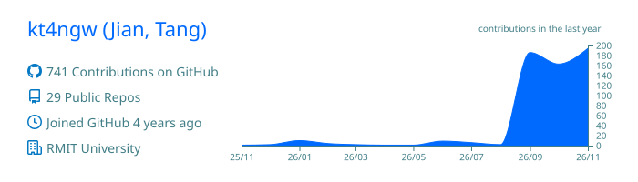

👋 Hi, I'm Jian Tang, a PhD student in the School of Computing Technologies at RMIT University, Melbourne, Australia.

- 🔬 Research: parameter-efficient fine-tuning of LLMs (LoRA) on heterogeneous, resource-constrained devices, and its privacy & security.
- 🌐 Homepage: [kt4ngw.github.io](https://kt4ngw.github.io/)
- 📧 Happy to chat about research or just make friends — drop me a line at [kt4ngw@gmail.com](mailto:kt4ngw@gmail.com).
- 💡 Motto: Hope for the best, but prepare for the worst.

|  |  |
| ------------------------------------------------------------ | ------------------------------------------------------------ |

<!--
**kt4ngw/kt4ngw** is a ✨ _special_ ✨ repository because its `README.md` (this file) appears on your GitHub profile.
- 🙋‍♂️ M.S. Software Engineering, Chongqing University, Chongqing, China (Jun. 2025); B.S. Engineering, Hunan University of Technology and Business, Changsha, China (Jun. 2022).
Here are some ideas to get you started:
- 👋 Hi, I’m @kt4ngw，
- 👀 I’m interested in ML, alogrithm
- 🌱 I’m currently learning ML and
- 📫 How to reach me: ...
- 😄 Pronouns: ...📌 
- ⚡ Fun fact: ...

-->
